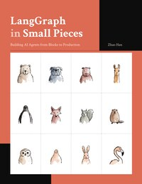

# LangGraph in Small Pieces

[home](../)

## Details

* **Title**: LangGraph in Small Pieces
* **Subtitle**: Building AI Agents from Blocks to Production
* **Authors**: Zhao Han
* **Publication Date**: 2026
* **Publisher**: Self-published, free online edition at lgisp.ai
* **Pages**: 31 chapters and 4 appendices
* **Amazon Rating**: n/a (free online book)
* **Goodreads Rating**: n/a

**Links**: [Read online](https://lgisp.ai) |
[GitHub Project](https://github.com/LgISP/langgraph-in-small-pieces)

## Blurb

LangGraph is the low-level framework for wiring language models into graphs you control. This book builds an agent one part at a time — a state, a node, an edge, a loop — until you can see exactly where the model's decisions enter and where your code keeps the guardrails.

Every chapter is built around a single runnable example. You can read the code on the page, but you are meant to run it, break it, and watch what happens. That is the whole method: build, run, observe, fix. Prose can look correct and be wrong; a graph that runs tells you the truth.

Most chapters end the same way: a Gotcha that names the trap before you fall into it, and Bronze, Silver and often Gold challenges, with worked solutions in the companion repository. Nothing here was written from the documentation alone — the examples were run, on the versions the Colophon names, and several claims changed once they were.

The default model is a local one (Qwen3.8-27B through LM Studio), so every example can be reproduced without an API bill; an appendix covers switching to hosted models.

## Contents

Part I — Building Graphs

0. Setup
1. The Smallest Graph
2. A Line of Nodes
3. The Agent Decides
4. Looping Until Enough
5. Tool Nodes
6. Save & Resume
7. Human in the Loop
8. Parallel & Reducers
9. Subgraphs

Part II — Empowering Graphs with LLMs

10. A Real LLM
11. Tool-Calling
12. State Schemas
13. The Functional API
14. Multi-Agent Supervisor
15. Memory & Long Conversations
16. Streaming
17. Middleware
18. Testing

Part III — Graphs in Production

19. Error Handling
20. Serving over HTTP
21. Async at Scale
22. Observability
23. MCP: External Tools
24. Inside Persistence
25. RAG Foundations
26. Chunking
27. Query Rewrite & Reranking
28. Versioning & Blue-Green
29. The Golden Layer
30. Evaluation Harness
31. Before You Ship

Appendices: Using Other LLMs, Class Map, Pattern Map, Other Frameworks
